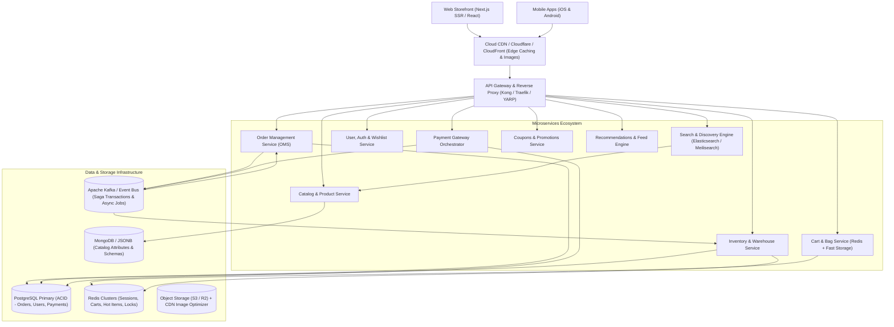
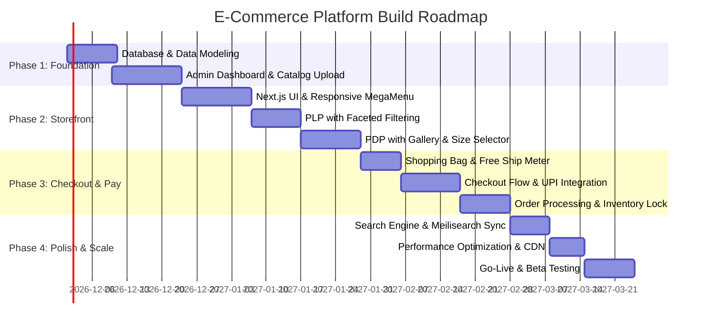

# Nykaa Fashion (nykaafashion.com) Complete Reverse-Engineering Blueprint

## 1. Executive Summary & Business Architecture

Nykaa Fashion is one of India's premier curated multi-brand fashion & lifestyle e-commerce ecosystems. Unlike mass-market horizontal marketplaces (like Amazon or Flipkart) that compete primarily on volume and price discounting, Nykaa Fashion operates an **editorial-first, curated lifestyle marketplace model** with high visual appeal, aspirational brand positioning, and curated designer labels (*Nykaa Luxe*).

### 1.1 Core Business Model
* **Curated Multi-Brand Marketplace:** Hosts thousands of verified third-party national, international, and D2C fashion brands alongside premium luxury designers.
* **Direct-to-Consumer (D2C) In-House Private Labels:** Operates proprietary private labels with higher profit margins (e.g., *RSVP*, *Twenty Dresses*, *Gajra Gang*, *Azai*, *Likha*, *Nykd by Nykaa*).
* **The "Luxe" Sub-Brand:** A dedicated luxury portal within the app/web targeting high-ticket ethnic and western designer wear (e.g., *Ritu Kumar*, *Masaba*, *House of Kotwara*).
* **Content-to-Commerce Integration:** "Style Files", trend edits, influencer showcases, and curated lookbooks that transform browsing into lifestyle consumption.

---

## 2. High-Level System Architecture

Nykaa Fashion utilizes a **microservices-oriented, event-driven architecture** with high-throughput edge caching and Server-Side Rendering (SSR) for search engine discovery.



---

## 3. UI/UX Page Breakdown & Section Hierarchy

### 3.1 Global Header (Sitewide Sticky Navigation)
1. **Top Announcement Ticker:**
   - Visual marquee or rotating text banner (e.g., *"Free shipping on orders above ₹799"* | *"Extra 10% off with code FIRST10"*).
2. **Main Navigation Bar:**
   - **Logo:** High-contrast Nykaa Fashion vector brand mark.
   - **Primary Demographic Tabs:** `Women`, `Men`, `Kids`, `Home`, `Tech`, `All Brands`, `Luxe`, `Sale`.
   - **Predictive Search Bar:**
     - Instant auto-complete with search history pills.
     - Trending search terms (*"Kurta sets"*, *"Maxi dresses"*, *"Sneakers"*).
     - Thumbnail preview of top-matched products and brand suggestions.
   - **Quick Action Icons:**
     - User Profile / Login trigger (Dropdown: Orders, Wishlist, Saved Cards, Contact Us).
     - Wishlist Heart Counter (badge showing total saved items).
     - Shopping Bag Icon with real-time item counter pill and slide-over mini-bag preview.
3. **Mega-Menu Overlay (Hover Trigger):**
   - 5-6 column multi-level dropdown layout categorized into Occasions, Silhouettes, and Brand Hubs.
   - Visual "Featured Designer / Campaign of the Week" banner right inside the mega menu.

---

### 3.2 Homepage Modules & Visual Sections (Top to Bottom)

| # | Section Name | Layout & Component Type | Business Purpose |
|---|---|---|---|
| **1** | **Hero Banner Slider** | Edge-to-edge carousel (16:9 / 21:9 desktop, 4:5 mobile) with auto-play & touch-swipe | Showcases flagship sales, new designer launches, and high-margin campaigns. |
| **2** | **Sub-Hero Spotlight Grid** | 2-column or 3-column split card grid | Drives secondary seasonal traffic (e.g., "Festive Edit", "Workwear Chic"). |
| **3** | **Circular Category Showcase** | Horizontally scrollable circular icon/thumbnail row | Quick 1-tap navigation for mobile shoppers to deep dive into core categories. |
| **4** | **Bank & Wallet Offer Strip** | Slim full-width banner strip | Increases checkout conversion by highlighting partner card discounts (HDFC, ICICI, etc.). |
| **5** | **"Nykaa Luxe" Designer Edit** | Dark / Minimalist luxury-themed section with metallic accents | Signals exclusivity for high-ticket designer couture (Ritu Kumar, Masaba, etc.). |
| **6** | **Flash Sale / "Deals of the Day"** | Product card carousel with dynamic countdown timer | Triggers FOMO (Fear Of Missing Out) and urgency-driven impulse purchases. |
| **7** | **Curated Concept Stores / Moodboards** | Asymmetrical editorial collage tiles ("Vacation Edit", "Wedding Store") | Solves the "what to wear" dilemma through contextual styling. |
| **8** | **"Editor's Picks / Nykaa Loves"** | 4-column product card carousel | Highlights trending, high-converting catalog pieces with social proof. |
| **9** | **Brand Spotlight Carousel** | Sliding brand logo grid | Leverages brand loyalty for direct brand store exploration. |
| **10** | **Influencer & Style Files Feed** | Instagram-style 9:16 vertical cards with "Shop the Look" tag | Content-to-commerce engine connecting social proof directly to product cards. |
| **11** | **Value Propositions Bar** | 4-pillar trust icons: 100% Authentic, Easy 15-Day Returns, Secure Payments, Express Shipping | Reassures first-time buyers and minimizes checkout bounce rate. |
| **12** | **Comprehensive Footer** | Multi-column links: Company, Help, Legal, App Download badges, Newsletter signup | SEO link juice, regulatory compliance, and app store download acquisition. |

---

### 3.3 Product Listing Page (PLP) & Search Results

```text
┌────────────────────────────────────────────────────────────────────────┐
│ Breadcrumbs: Home > Women > Indianwear > Kurtas & Sets                 │
├────────────────────────────────────────────────────────────────────────┤
│ Title: Kurtas & Sets for Women (24,510 items)                          │
├──────────────────┬─────────────────────────────────────────────────────┤
│ FILTERS (Sticky) │ [Sort By: Relevance ▼]  [View: 4 Col / 2 Col]       │
│                  │ Active Filter Pills: [Size: M ✕] [Brand: Biba ✕]    │
│ • Category       ├─────────────────────────────────────────────────────┤
│ • Brand (Search) │ ┌───────────┐ ┌───────────┐ ┌───────────┐ ┌───────┐ │
│ • Size & Fit     │ │  [Image]  │ │  [Image]  │ │  [Image]  │ │ [Img] │ │
│ • Price Slider   │ │ Brand     │ │ Brand     │ │ Brand     │ │ Brand │ │
│ • Discount %     │ │ Title     │ │ Title     │ │ Title     │ │ Title │ │
│ • Color Swatches │ │ ₹1,499 50%│ │ ₹2,199 40%│ │ ₹999 60%  │ │ ₹...  │ │
│ • Fabric         │ └───────────┘ └───────────┘ └───────────┘ └───────┘ │
│ • Occasion       │ ┌───────────┐ ┌───────────┐ ┌───────────┐ ┌───────┐ │
│ • Sleeve/Neckline│ │  [Image]  │ │ [PROMO BANNER TILE]     │ │ [Img] │ │
│                  │ └───────────┘ └─────────────────────────┘ └───────┘ │
│ [Clear All]      │ [Infinite Scroll Loading Trigger...]                │
└──────────────────┴─────────────────────────────────────────────────────┘
```

* **Faceted Filtering Engine:** Multi-select checkboxes with real-time count updates (`Biba (420)`, `W (310)`).
* **Interstitial Editorial Banners:** Promotional banner tiles placed directly inside the product grid at intervals (e.g., after every 12th card) to break monotony and push featured offers.
* **Responsive Layout:**
  - Desktop: 4 columns with sticky left filter panel.
  - Mobile: 2 columns with sticky bottom floating "Sort" and "Filter" buttons opening a full-screen drawer.

---

### 3.4 Product Details Page (PDP)

1. **Media Showcase (Left Half on Desktop, Top Carousel on Mobile):**
   - High-definition portrait gallery (3:4 ratio).
   - Multi-angle views: Front on-model, Back on-model, Side pose, Close-up fabric texture, Full styling look.
   - Integrated runway video clip (10-15s auto-looping without sound).
   - High-magnification pinch-to-zoom / hover-zoom lens.
2. **Product Identification & Pricing (Right Half):**
   - Brand Name (Bold, clickable to Brand Store).
   - Product Title & Style Code.
   - Pricing Structure:
     - Selling Price (Prominent bold text).
     - Maximum Retail Price (MRP) strikethrough.
     - Discount Tag (`50% OFF`).
     - Tax clarification (*"Inclusive of all taxes"*).
   - Ratings Badge: Star rating + review count + verified buyer tag.
3. **Interactive Size & Variant Selector:**
   - Color Swatches (thumbnails of sibling SKUs with active ring selector).
   - Size Selector Pills (`XS`, `S`, `M`, `L`, `XL`, `XXL`).
   - Visual stock states: Available, Out of stock (dimmed + strikethrough), Low stock urgency (*"Only 2 left in stock!"*).
   - Size Guide Modal: Dual-tab (Inches / CM) detailing Bust, Waist, Hips, Length, and model height reference (*"Model is 5'8\" wearing size S"*).
4. **Logistics & Serviceability Widget:**
   - Pincode Input Box with instant validation.
   - Estimated Delivery Date calculation (e.g., *"Delivered by Thursday, 28th Nov"*).
   - Cash on Delivery (COD) availability confirmation.
   - 15-Day Return & Exchange Policy callout.
5. **Coupons & Promotional Offers Box:**
   - Expandable coupon card showing highest savings coupon with a 1-click "Apply" button.
6. **Dual Action CTA Bar:**
   - **"Add to Bag"** (High-contrast primary button with cart icon).
   - **"Wishlist"** (Outlined heart icon with micro-animation on toggle).
   - Persistent sticky bottom bar on mobile view.
7. **Rich Content Accordions:**
   - Product Details (Style code, Fabric, Care instructions, Pattern, Neckline, Sleeve length, Fit, Weave type).
   - About the Brand.
   - Manufacturer / Importer details & Country of Origin (Regulatory requirement).
8. **Recommendation Engines:**
   - *"Complete the Look"* (Cross-sell: matching earrings, footwear, or bags).
   - *"Similar Styles You May Like"* (Collaborative filtering).
   - *"Customers Also Viewed"*.
9. **User Reviews & UGC Photo Gallery:**
   - Summary rating bar chart (5-star breakdown).
   - Customer-uploaded real-life photos grid.
   - Verified buyer review cards with fit feedback (*"True to size"*, *"Slightly loose"*).

---

### 3.5 Shopping Bag (Cart) & 2-Step Checkout

1. **Shopping Bag Features:**
   - **Free Delivery Progress Meter:** Gamified visual bar (*"Add items worth ₹251 more to get FREE Delivery"*).
   - **Product Row Component:** Thumbnail, Brand, Title, Variant (Size, Color), Unit Price, Discount, Quantity selector (1-5), *"Move to Wishlist"*, *"Remove"*.
   - **Coupon Drawer:** Curated list of eligible coupons with calculated savings.
   - **Bill Details Breakdown:** Total MRP, Product Discount, Coupon Discount, Shipping Fee, Total Payable Amount.
2. **Frictionless Checkout Flow:**
   - **Step 1: Address:** Stored address cards with 1-click selection, Pincode auto-detection (City/State), Landmark support.
   - **Step 2: Payment:**
     - **UPI:** Instant launch of PhonePe, Google Pay, Paytm, BHIM.
     - **Saved Cards & Tokenization:** RBI / PCI-DSS compliant saved card tokens.
     - **Net Banking & Wallets:** Major Indian & international banks.
     - **Cash on Delivery (COD):** Optional small handling fee to disincentivize returns.
   - **Order Confirmation Page:**
     - Animated success checkmark.
     - Order Reference ID, tracking link, and expected delivery date.
     - WhatsApp notification opt-in toggle.
     - Post-purchase recommendations.

---

## 4. Product Card Component Design & Micro-Interactions

The product card is the most critical micro-unit of an e-commerce platform. Nykaa Fashion uses a signature editorial aesthetic:

```text
┌──────────────────────────────────────────────┐
│ [BESTSELLER]                   [♡ Wishlist]  │
│                                              │
│                                              │
│               3:4 PORTRAIT                   │
│               PRODUCT PHOTO                  │
│          (Hover: Flips to back/model pose)   │
│                                              │
│                                              │
│  [QUICK ADD: XS | S | M | L ] (On Hover)     │
├──────────────────────────────────────────────┤
│ BIBA                                         │
│ Women Floral Printed Pure Cotton Kurta Set   │
│ ₹1,799   ₹3,999   (55% Off)                  │
│ ★ 4.3 (124)                                  │
└──────────────────────────────────────────────┘
```

### Component Specification:
* **Aspect Ratio:** Strictly `3:4` portrait (e.g., 300px width x 400px height or 600x800 for Retina).
* **Hover State (Desktop):**
  - Smooth 200ms cross-fade swap from Image 1 (Front on-model) to Image 2 (Back view or detailed drape).
  - Emergence of the "Quick Add / Available Sizes" pill bar over the bottom edge of the image.
* **Wishlist Heart:**
  - Placed top-right on a semi-transparent circular backdrop.
  - Micro-animation: Pulsing spring scale animation with fill color transitioning to `#FF1493` (Deep Pink).
* **Badges:**
  - Placed top-left: Distinct colored badges for `"Luxe"`, `"Bestseller"`, `"New Season"`, `"Conscious"`.
* **Typography:**
  - Brand Name: Bold, 12-14px, uppercase, letter-spaced.
  - Title: 13-14px, regular/medium, truncated with ellipsis after 1 or 2 lines.
  - Price: Bold 15-16px `#111827`.
  - Strikethrough MRP: 13px muted gray `#6B7280`.
  - Discount Tag: 13px bold green `#059669` or brand pink `#E11D48`.
  - Rating Badge: Light background pill `#F3F4F6` with star icon and review count.

---

## 5. Category Taxonomy & Navigation Hierarchy

Nykaa Fashion balances multi-gender and lifestyle demographics with deep occasion-based subcategories:

```
├── WOMEN
│   ├── Indianwear
│   │   ├── Kurtas & Kurtis
│   │   ├── Kurta Sets & Suits
│   │   ├── Sarees (Ready to wear, Silk, Organza, Chiffon)
│   │   ├── Lehengas & Blouses
│   │   ├── Palazzos, Salwars & Pants
│   │   ├── Dupattas & Shawls
│   │   └── Ethnic Gowns & Fusion Wear
│   ├── Westernwear
│   │   ├── Dresses (Maxi, Midi, Bodycon, Shift)
│   │   ├── Tops, Tunics & Shirts
│   │   ├── T-Shirts & Polos
│   │   ├── Jeans, Jeggings & Trousers
│   │   ├── Skirts & Shorts
│   │   ├── Jackets, Coats & Blazers
│   │   └── Sweaters, Cardigans & Sweatshirts
│   ├── Footwear
│   │   ├── Flats, Sliders & Kolhapuris
│   │   ├── Heels, Pumps & Stilettos
│   │   ├── Sneakers & Casual Shoes
│   │   ├── Boots & Loafers
│   │   └── Ethnic Juttis & Mojris
│   ├── Lingerie & Sleepwear
│   │   ├── Bras (T-Shirt, Sports, Bralette, Push-up)
│   │   ├── Panties & Briefs
│   │   ├── Night suits, Pyjamas & Chemises
│   │   └── Shapewear & Camisoles
│   ├── Bags & Wallets
│   │   ├── Handbags, Totes & Shoulder Bags
│   │   ├── Sling & Crossbody Bags
│   │   ├── Clutches & Potlis
│   │   └── Backpacks & Wallets
│   └── Jewellery & Accessories
│       ├── Earrings, Necklaces & Chokers
│       ├── Bangles, Bracelets & Rings
│       ├── Fine & Silver Jewellery
│       ├── Watches & Sunglasses
│       └── Belts, Scarves & Hair Accessories
│
├── MEN
│   ├── Topwear (Shirts, T-shirts, Polos, Hoodies, Jackets)
│   ├── Bottomwear (Jeans, Chinos, Trousers, Shorts, Trackpants)
│   ├── Ethnic Wear (Kurtas, Kurta Sets, Nehru Jackets, Sherwanis)
│   ├── Footwear (Sneakers, Casual Shoes, Formal Shoes, Sandals)
│   └── Accessories & Innerwear (Watches, Wallets, Belts, Boxers, Vests)
│
├── KIDS
│   ├── Girls (Frocks, Lehengas, Tops, Sets)
│   ├── Boys (T-shirts, Shirts, Kurta sets, Denims)
│   ├── Baby (Rompers, Onesies, Booties)
│   └── Footwear & Toys
│
├── LUXE (High-End Designer Portal)
│   ├── Designer Indianwear
│   ├── Designer Westernwear
│   ├── Luxury Bags & Fine Accessories
│   └── Featured Designers (Masaba, Ritu Kumar, Tarun Tahiliani, etc.)
│
├── HOME & LIVING
│   ├── Bed Linen & Cushions
│   ├── Dining & Kitchenware
│   ├── Decor & Vases
│   └── Bath Essentials & Fragrances
│
└── SALE & CLEARANCE
    ├── Flat 50% Off
    ├── Under ₹999 Store
    ├── Clearance Steals
    └── Designer Sale
```

---

## 6. Images, Media, Banners & CDN Architecture

Fashion e-commerce conversion is 90% driven by visual fidelity, zoom capability, and lightning-fast image delivery.

### 6.1 Aspect Ratio & Resolution Standards

| Asset Type | Ratio | Ideal Resolution | Formats | Delivery Strategy |
|---|---|---|---|---|
| **Product Gallery** | `3:4` | `1200 x 1600 px` (Retina) / `900 x 1200 px` (Standard) | WebP, AVIF, Fallback JPEG | Progressive lazy load, dynamic edge resizing, smart face/body cropping. |
| **Desktop Hero Banners** | `16:9` or `21:9` | `1920 x 800 px` / `2560 x 1080 px` | WebP, AVIF | Preloaded high priority (`fetchpriority="high"`), responsive `<picture>`. |
| **Mobile Hero Banners** | `4:5` or `1:1` | `1080 x 1350 px` / `1080 x 1080 px` | WebP, AVIF | Swapped via media queries (`<source media="(max-width: 768px)">`). |
| **Category Showcase Icons** | `1:1` | `300 x 300 px` | WebP, PNG | Rounded circle clipping, inline SVG skeleton loader. |
| **Brand Logos** | `16:9` / `3:2` | `400 x 200 px` | SVG (preferred), transparent PNG | Grayscale to color transition on hover. |
| **Runway / Look Videos** | `9:16` | `1080 x 1920 px` (H.264 / H.265 / AV1) | MP4 / WebM / HLS stream | Muted, auto-looping, streaming via Cloudflare Stream or AWS CloudFront. |

### 6.2 Responsive HTML5 `<picture>` Implementation Example
```html
<picture>
  <!-- Mobile screens: Vertical banner -->
  <source media="(max-width: 768px)" srcset="banner-mobile.avif" type="image/avif">
  <source media="(max-width: 768px)" srcset="banner-mobile.webp" type="image/webp">
  <!-- Desktop screens: Panoramic banner -->
  <source media="(min-width: 769px)" srcset="banner-desktop.avif" type="image/avif">
  <source media="(min-width: 769px)" srcset="banner-desktop.webp" type="image/webp">
  <!-- Fallback -->
  
</picture>
```

---

## 7. Database Schemas & Data Models

### 7.1 PostgreSQL Relational Data Models (Orders, Users, Inventory)

```sql
-- 1. Brands Table
CREATE TABLE brands (
    id UUID PRIMARY KEY DEFAULT gen_random_uuid(),
    name VARCHAR(255) NOT NULL,
    slug VARCHAR(255) UNIQUE NOT NULL,
    logo_url TEXT,
    banner_url TEXT,
    description TEXT,
    is_luxe BOOLEAN DEFAULT FALSE,
    is_active BOOLEAN DEFAULT TRUE,
    created_at TIMESTAMP WITH TIME ZONE DEFAULT CURRENT_TIMESTAMP
);

-- 2. Categories Table (Hierarchical tree)
CREATE TABLE categories (
    id UUID PRIMARY KEY DEFAULT gen_random_uuid(),
    parent_id UUID REFERENCES categories(id) ON DELETE SET NULL,
    name VARCHAR(255) NOT NULL,
    slug VARCHAR(255) UNIQUE NOT NULL,
    image_url TEXT,
    display_order INT DEFAULT 0,
    is_active BOOLEAN DEFAULT TRUE,
    created_at TIMESTAMP WITH TIME ZONE DEFAULT CURRENT_TIMESTAMP
);

-- 3. Products Table (Parent Item)
CREATE TABLE products (
    id UUID PRIMARY KEY DEFAULT gen_random_uuid(),
    brand_id UUID NOT NULL REFERENCES brands(id),
    category_id UUID NOT NULL REFERENCES categories(id),
    title VARCHAR(500) NOT NULL,
    slug VARCHAR(500) UNIQUE NOT NULL,
    description TEXT,
    fabric_and_care TEXT,
    specifications JSONB DEFAULT '{}', -- Flexible fashion specs: fit, neckline, pattern, length
    gender VARCHAR(50) NOT NULL, -- Women, Men, Unisex, Kids
    is_luxe BOOLEAN DEFAULT FALSE,
    is_featured BOOLEAN DEFAULT FALSE,
    status VARCHAR(50) DEFAULT 'ACTIVE', -- ACTIVE, DRAFT, ARCHIVED
    rating_average NUMERIC(3,2) DEFAULT 0.0,
    rating_count INT DEFAULT 0,
    created_at TIMESTAMP WITH TIME ZONE DEFAULT CURRENT_TIMESTAMP,
    updated_at TIMESTAMP WITH TIME ZONE DEFAULT CURRENT_TIMESTAMP
);

-- 4. Product Variants (SKU Level: Sizes, Colors, Inventory, Barcodes)
CREATE TABLE product_variants (
    id UUID PRIMARY KEY DEFAULT gen_random_uuid(),
    product_id UUID NOT NULL REFERENCES products(id) ON DELETE CASCADE,
    sku_code VARCHAR(100) UNIQUE NOT NULL,
    size VARCHAR(50) NOT NULL, -- XS, S, M, L, XL, etc.
    color_name VARCHAR(100) NOT NULL, -- Navy Blue, Blush Pink
    color_hex VARCHAR(7), -- #000080
    mrp_price NUMERIC(10,2) NOT NULL, -- Maximum Retail Price
    selling_price NUMERIC(10,2) NOT NULL, -- Discounted Price
    stock_quantity INT NOT NULL DEFAULT 0,
    reserved_quantity INT NOT NULL DEFAULT 0, -- Locked during checkout
    is_active BOOLEAN DEFAULT TRUE,
    created_at TIMESTAMP WITH TIME ZONE DEFAULT CURRENT_TIMESTAMP
);

-- 5. Product Images & Media
CREATE TABLE product_images (
    id UUID PRIMARY KEY DEFAULT gen_random_uuid(),
    product_id UUID NOT NULL REFERENCES products(id) ON DELETE CASCADE,
    color_name VARCHAR(100), -- Associated color variant
    image_url TEXT NOT NULL,
    thumbnail_url TEXT NOT NULL,
    display_order INT DEFAULT 0,
    is_primary BOOLEAN DEFAULT FALSE,
    created_at TIMESTAMP WITH TIME ZONE DEFAULT CURRENT_TIMESTAMP
);

-- 6. Users & Customers
CREATE TABLE users (
    id UUID PRIMARY KEY DEFAULT gen_random_uuid(),
    phone_number VARCHAR(20) UNIQUE NOT NULL,
    email VARCHAR(255) UNIQUE,
    full_name VARCHAR(255),
    gender VARCHAR(20),
    is_verified BOOLEAN DEFAULT FALSE,
    reward_points INT DEFAULT 0,
    created_at TIMESTAMP WITH TIME ZONE DEFAULT CURRENT_TIMESTAMP
);

-- 7. Addresses
CREATE TABLE user_addresses (
    id UUID PRIMARY KEY DEFAULT gen_random_uuid(),
    user_id UUID NOT NULL REFERENCES users(id) ON DELETE CASCADE,
    name VARCHAR(255) NOT NULL,
    phone VARCHAR(20) NOT NULL,
    address_line1 TEXT NOT NULL,
    address_line2 TEXT,
    landmark TEXT,
    pincode VARCHAR(10) NOT NULL,
    city VARCHAR(100) NOT NULL,
    state VARCHAR(100) NOT NULL,
    address_type VARCHAR(20) DEFAULT 'HOME', -- HOME, WORK, OTHER
    is_default BOOLEAN DEFAULT FALSE,
    created_at TIMESTAMP WITH TIME ZONE DEFAULT CURRENT_TIMESTAMP
);

-- 8. Orders Table
CREATE TABLE orders (
    id UUID PRIMARY KEY DEFAULT gen_random_uuid(),
    order_number VARCHAR(50) UNIQUE NOT NULL,
    user_id UUID NOT NULL REFERENCES users(id),
    shipping_address_id UUID NOT NULL REFERENCES user_addresses(id),
    total_mrp NUMERIC(10,2) NOT NULL,
    discount_amount NUMERIC(10,2) DEFAULT 0.0,
    coupon_discount NUMERIC(10,2) DEFAULT 0.0,
    shipping_fee NUMERIC(10,2) DEFAULT 0.0,
    final_amount NUMERIC(10,2) NOT NULL,
    payment_status VARCHAR(50) DEFAULT 'PENDING', -- PENDING, PAID, FAILED, REFUNDED
    order_status VARCHAR(50) DEFAULT 'PLACED', -- PLACED, CONFIRMED, PACKED, SHIPPED, DELIVERED, CANCELLED
    tracking_number VARCHAR(100),
    created_at TIMESTAMP WITH TIME ZONE DEFAULT CURRENT_TIMESTAMP,
    updated_at TIMESTAMP WITH TIME ZONE DEFAULT CURRENT_TIMESTAMP
);

-- 9. Order Items Table
CREATE TABLE order_items (
    id UUID PRIMARY KEY DEFAULT gen_random_uuid(),
    order_id UUID NOT NULL REFERENCES orders(id) ON DELETE CASCADE,
    variant_id UUID NOT NULL REFERENCES product_variants(id),
    product_title VARCHAR(500) NOT NULL,
    brand_name VARCHAR(255) NOT NULL,
    size VARCHAR(50) NOT NULL,
    color VARCHAR(100) NOT NULL,
    unit_price NUMERIC(10,2) NOT NULL,
    quantity INT NOT NULL DEFAULT 1,
    subtotal NUMERIC(10,2) NOT NULL,
    created_at TIMESTAMP WITH TIME ZONE DEFAULT CURRENT_TIMESTAMP
);
```

---

## 8. Core API Specification (RESTful Endpoints)

### 8.1 Catalog & Product Discovery APIs
* `GET /api/v1/home/layout`
  - Returns homepage structured sections, banners, carousels, and promos.
* `GET /api/v1/categories/tree`
  - Returns hierarchical category taxonomy for the mega-menu.
* `GET /api/v1/products`
  - Query parameters: `category_id`, `brand_id`, `gender`, `sizes`, `colors`, `price_min`, `price_max`, `discount_min`, `sort`, `page`, `limit`.
  - Response: Paginated product cards with active facet aggregates.
* `GET /api/v1/products/{slug}`
  - Returns full PDP payload: Media gallery, variants, sizes, size guide, seller details, coupons, and similar styles.
* `GET /api/v1/search/autocomplete?q={query}`
  - Instant predictive search results (categories, brands, top product suggestions).

### 8.2 User & Wishlist APIs
* `POST /api/v1/auth/send-otp` | `POST /api/v1/auth/verify-otp`
  - Passwordless phone OTP authentication.
* `GET /api/v1/user/wishlist`
  - Returns user's saved wishlist items.
* `POST /api/v1/user/wishlist/toggle`
  - Payload: `{"product_id": "..."}` - Adds or removes product from wishlist.

### 8.3 Cart & Checkout APIs
* `GET /api/v1/cart`
  - Returns cart items, real-time prices, stock validation, and bill summary.
* `POST /api/v1/cart/items`
  - Payload: `{"variant_id": "...", "quantity": 1}`.
* `DELETE /api/v1/cart/items/{item_id}`
  - Removes item or moves it to wishlist.
* `POST /api/v1/coupons/apply`
  - Payload: `{"code": "SUMMER500"}` - Returns updated bill summary with savings.
* `POST /api/v1/checkout/create-order`
  - Locks inventory, verifies address, and returns Razorpay / Cashfree / Stripe payment token.
* `POST /api/v1/checkout/verify-payment`
  - Webhook & client callback validating payment signature and triggering Order Placement event.

---

## 9. Recommended Modern Tech Stack for Your Business

To build a high-performance Nykaa Fashion clone optimized for conversion, SEO, and scalability:

| Tier | Recommended Technologies | Why This Choice |
|---|---|---|
| **Frontend Web** | **Next.js 14/15 (App Router, React 19, TypeScript, Tailwind CSS)** | Best-in-class Server-Side Rendering (SSR) for e-commerce SEO, instant route prefetching, and optimal Core Web Vitals (LCP < 1.2s). |
| **Mobile Apps** | **React Native / Expo** or **Flutter** | Shares 80%+ business logic with web, instant updates, and smooth native 60fps animations. |
| **UI Components** | **Radix UI / Shadcn UI + Framer Motion** | Fully accessible (a11y), customizable, fluid spring animations for cards and drawers. |
| **Backend API** | **Node.js (NestJS / Fastify) or Go (Golang)** | High-throughput, asynchronous event loop, clean modular architecture. |
| **Search Engine** | **Meilisearch / Typesense or OpenSearch** | Millisecond typo-tolerant search, faceted filtering, and synonym search without massive cluster costs. |
| **Database** | **PostgreSQL (Supabase / AWS RDS) + Redis** | Relational ACID compliance for orders/payments + Redis for real-time cart and inventory locking. |
| **Cloud & Media** | **Cloudflare Images / Cloudinary + Cloudflare R2** | Auto-formatting to AVIF/WebP, on-the-fly responsive resizing, and edge delivery. |
| **Payments** | **Razorpay / Cashfree / Stripe** | Seamless support for UPI Intent, Netbanking, Cards, and PayLater. |

---

## 10. Step-by-Step Implementation Roadmap



1. **Phase 1: Foundation & Catalog Management (Weeks 1-3)**
   - Set up PostgreSQL schema (Brands, Categories, Products, SKUs, Images).
   - Build lightweight Admin Panel (Strapi / Directus or Custom Next.js Admin) to manage products and multi-angle fashion imagery.
2. **Phase 2: Storefront & Browsing Experience (Weeks 4-6)**
   - Build Header, Announcement Ticker, and Multi-Column Mega-Menu.
   - Implement Homepage modular sections (Hero carousel, Curated edits, Brand sliders).
   - Build PLP with live faceted filtering (Size, Brand, Price, Color) and 3:4 aspect-ratio Product Cards.
   - Build high-conversion PDP (Image zoom gallery, Size selector with stock indicators, Size Guide modal).
3. **Phase 3: Bag, Checkout & Payments (Weeks 7-9)**
   - Develop slide-over Bag drawer with gamified free-shipping progress meter.
   - Implement Address manager with automatic Pincode validation.
   - Integrate Payment Gateway (UPI fast-lane, Cards, Netbanking, COD).
   - Implement Redis-based atomic inventory deduction to prevent overselling.
4. **Phase 4: Search, Personalization & Go-Live (Weeks 10-12)**
   - Sync catalog to Meilisearch / Typesense for predictive auto-complete.
   - Set up Cloudflare CDN with automatic WebP/AVIF media optimization.
   - Comprehensive cross-device responsive verification (Desktop, Tablet, Mobile).
